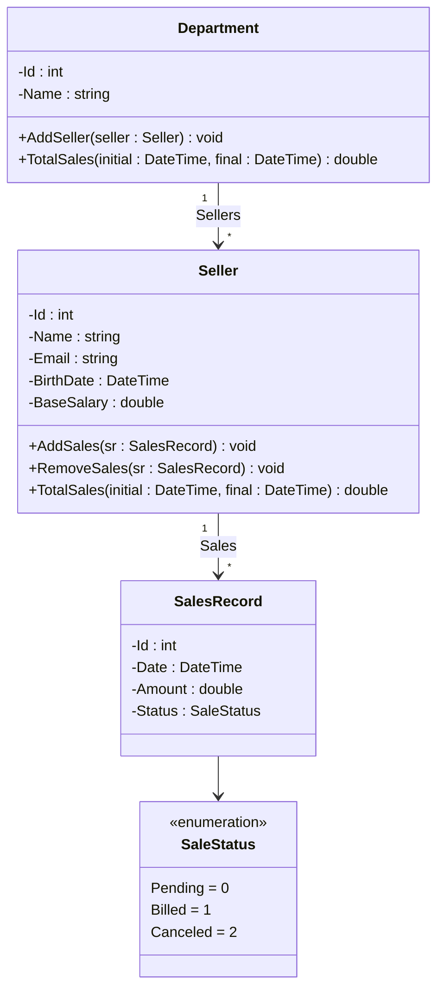

# SalesWebMvc

Projeto ASP.NET (Razor Pages / MVC) de exemplo para gerenciamento de vendas, desenvolvido com .NET 10.

## Visão geral
Aplicação demonstrativa com entidades principais:
- `Seller` (vendedor)
- `Department` (departamento)
- `SalesRecord` (registro de venda)
- `SaleStatus` (enum com o status da venda)

Implementa:
- Entity Framework Core (`SalesWebMvcContext`)
- Camada de `Services` para regras de negócio (ex.: `SellerService`, `DepartmentService`, `SalesRecordService`)
- Serviço de seed de dados chamado no startup (`SeedingService.Seed()`)

## Modelo de domínio

### Diagrama de classes



### Entidades

| Entidade | Atributos | Operações |
|---|---|---|
| `Seller` | `Id`, `Name`, `Email`, `BirthDate`, `BaseSalary` | `AddSales(SalesRecord)`, `RemoveSales(SalesRecord)`, `TotalSales(initial, final)` |
| `Department` | `Id`, `Name` | `AddSeller(Seller)`, `TotalSales(initial, final)` |
| `SalesRecord` | `Id`, `Date`, `Amount`, `Status` | — |
| `SaleStatus` (enum) | `Pending` (0), `Billed` (1), `Canceled` (2) | — |

### Relacionamentos
- **Department 1 — * Seller**: um departamento possui vários vendedores (`Department.Sellers`); cada vendedor pertence a um único departamento (`Seller.Department`).
- **Seller 1 — * SalesRecord**: um vendedor possui vários registros de venda (`Seller.Sales`); cada venda pertence a um único vendedor (`SalesRecord.Seller`).

### Regras de negócio
- `Seller.TotalSales(initial, final)`: soma o `Amount` das vendas do vendedor cuja `Date` esteja no intervalo informado.
- `Department.TotalSales(initial, final)`: soma o total de vendas de todos os vendedores do departamento no intervalo informado.
- `Seller.AddSales(sr)` / `Seller.RemoveSales(sr)`: adicionam ou removem um registro da coleção de vendas do vendedor.
- `Department.AddSeller(seller)`: adiciona um vendedor ao departamento.

### Exemplo de implementação (resumo)

```csharp
public class Seller
{
    public int Id { get; set; }
    public string Name { get; set; }
    public string Email { get; set; }
    public DateTime BirthDate { get; set; }
    public double BaseSalary { get; set; }
    public Department Department { get; set; }
    public ICollection<SalesRecord> Sales { get; set; } = new List<SalesRecord>();

    public void AddSales(SalesRecord sr) => Sales.Add(sr);
    public void RemoveSales(SalesRecord sr) => Sales.Remove(sr);

    public double TotalSales(DateTime initial, DateTime final) =>
        Sales.Where(sr => sr.Date >= initial && sr.Date <= final)
             .Sum(sr => sr.Amount);
}

public class Department
{
    public int Id { get; set; }
    public string Name { get; set; }
    public ICollection<Seller> Sellers { get; set; } = new List<Seller>();

    public void AddSeller(Seller seller) => Sellers.Add(seller);

    public double TotalSales(DateTime initial, DateTime final) =>
        Sellers.Sum(seller => seller.TotalSales(initial, final));
}

public class SalesRecord
{
    public int Id { get; set; }
    public DateTime Date { get; set; }
    public double Amount { get; set; }
    public SaleStatus Status { get; set; }
    public Seller Seller { get; set; }
}

public enum SaleStatus
{
    Pending = 0,
    Billed = 1,
    Canceled = 2
}
```

> Observação: o `SalesWebMvcContext` deve expor os `DbSet<Department>`, `DbSet<Seller>` e `DbSet<SalesRecord>`.

## Pré-requisitos
- .NET 10 SDK
- Microsoft Visual Studio 2026 (ou `dotnet` CLI)
- SQL Server LocalDB (padrão usado em `appsettings.json`) ou outro provedor compatível

## Configuração
1. Clone o repositório:
   git clone https://github.com/Brumassio/SalesWebMvc.git

2. Abra a solução em Visual Studio ou no terminal, navegue até a pasta do projeto:
   cd SalesWebMvc

3. Ajuste a string de conexão em `appsettings.json` se necessário:
   - Chave atual: `ConnectionStrings:SalesWebMvcContext`
   - Exemplo padrão atual:
     `Server=(localdb)\MSSQLLocalDB;Database=SalesWebMvcContext;Trusted_Connection=True;MultipleActiveResultSets=true`

## Banco de dados
- O projeto registra o `SeedingService` e o executa na inicialização do aplicativo para popular dados de exemplo.
- Para usar migrations EF Core (se desejar):
  - Instale as ferramentas EF Core globalmente (se ainda não instaladas):
    dotnet tool install --global dotnet-ef
  - Criar uma migration:
    dotnet ef migrations add InitialCreate --project SalesWebMvc --startup-project SalesWebMvc
  - Atualizar o banco:
    dotnet ef database update --project SalesWebMvc --startup-project SalesWebMvc

(ajuste os parâmetros `--project`/`--startup-project` conforme sua organização de pastas)

### Migrations do projeto

| Migration | Conteúdo |
|---|---|
| `InitialCreate` | Criação da entidade `Department` |
| `OtherEntities` | Criação das entidades `Seller` e `SalesRecord`, com as chaves estrangeiras `DepartmentId` (em `Seller`) e `SellerId` (em `SalesRecord`) |

Para gerar a segunda migration após adicionar as demais entidades:

```bash
dotnet ef migrations add OtherEntities --project SalesWebMvc --startup-project SalesWebMvc
dotnet ef database update --project SalesWebMvc --startup-project SalesWebMvc
```

### Dados de exemplo (seed)
O `SeedingService.Seed()` verifica se já existem registros (`Department`, `Seller` ou `SalesRecord`) e, caso o banco esteja vazio, popula:
- Departamentos (ex.: Computers, Electronics, Fashion, Books);
- Vendedores associados a cada departamento;
- Registros de venda com diferentes status (`Pending`, `Billed`, `Canceled`).

## Executar
- Visual Studio: abrir a solução e executar (F5).
- CLI:
  dotnet run --project SalesWebMvc

Ao iniciar, o aplicativo executa o seeding e estará disponível em `https://localhost:5001` (ou porta configurada).

## Estrutura importante
- `Data/` - `SalesWebMvcContext` (DbContext)
- `Models/` - entidades (`Seller`, `Department`, `SalesRecord`) e enums (`Enums/SaleStatus`)
- `Services/` - lógica de negócio e seed (`SeedingService`, `SellerService`, etc.)
- `Program.cs` - configuração do host, DI, EF Core e roteamento

## Contribuição
Pull requests são bem-vindos. Abra issues para problemas ou sugestões.
